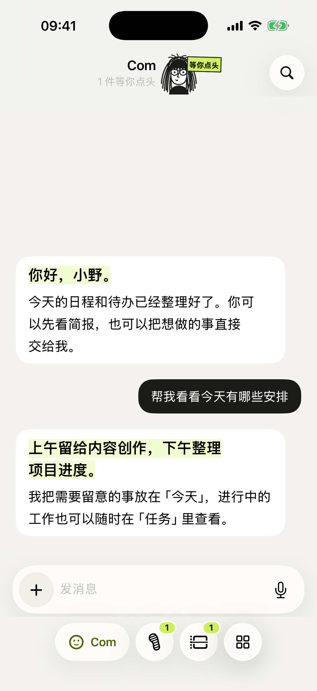
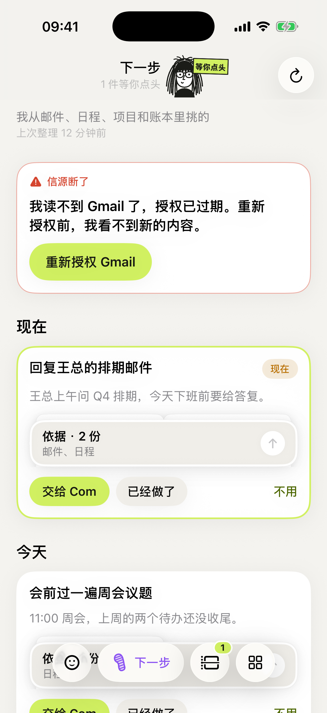
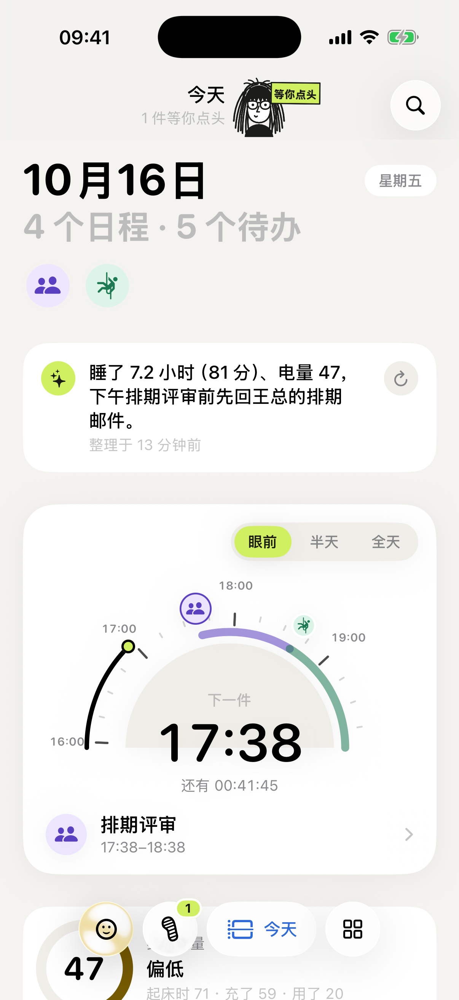
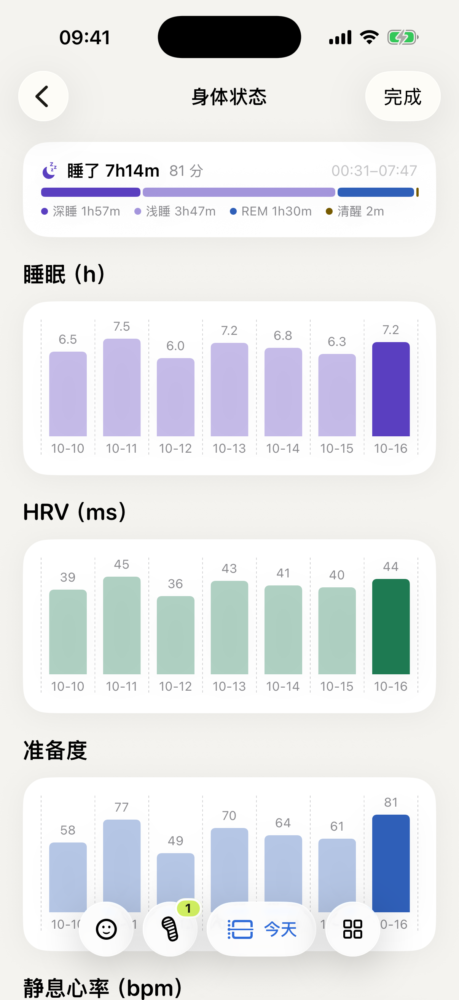

# Com

Com 是我给自己做的一个手机上的 AI 助手。

我的邮件、日历、账本、微信、健康数据和写代码的 Agent 原本散在十几个地方，每天要翻一圈才知道今天该干嘛。Com 把这些接到一起，让一个常驻的 AI 替我看着，有事它会告诉我，我也可以随口把事情交给它去办。

它跑在家里一台 Mac mini 上，手机只是窗口。所以我不在电脑前的时候，电脑上的工作也不会停，我随时能看进度、补一句话、点个头。

  
  
  
  

截图来自 iOS 模拟器，里面是演示数据，不是我的真实邮件和健康记录。

## 四个页面

**Com · 对话**
就是跟它聊天。打字或者按住说话都行，想到什么直接丢给它：「帮我看看今天有哪些安排」「这笔 38 块的午饭记一下」「把这个项目的测试跑一遍」。它能自己查日程、记账、翻记忆，也能去电脑上真的动手。需要我拍板的时候，它会停下来问，不会闷头乱做。

**下一步**
它每隔一阵会把我的邮件、日历、项目进度、账本和微信翻一遍，挑出几件我该做的事。每一条都写着依据，比如「王总上午问了 Q4 排期，下班前要答复」，后面跟着邮件和日程的出处。我可以点「交给 Com」让它去办，点「已经做了」或者「不用」把它划掉。哪个信源断了（比如 Gmail 授权过期），也会直接显示在这一页。

**今天**
早上打开看的那一页。顶上是一句今日简报，下面是一个表盘，指着下一件事还有多久。再往下是 Garmin 的身体电量、睡眠和 HRV，待办和日程，微信里有人找我的摘要，还有这几天的花销。点进身体卡可以看一周的趋势。

**工作**
我电脑上跑着的 Codex、Claude Code 和 Pi 会话都列在这里，MacBook 和 Mac mini 两台机器的都有。可以看它们做到哪了，给任何一个会话发指令，批准或拒绝它们要执行的危险操作。人不在电脑前，也不会错过它们在等我的那一下。

## 其他的小东西

- **顶上那个小人**会随状态变：在忙、在等我、出错了，一眼就能看出来
- **记账**：说一句话就记进账本，月底看分类和明细
- **记忆**：它记得我的偏好和做过的决定，可以翻看和修改
- **锁屏和桌面**：Live Activity 显示它正在干什么，桌面小组件显示待办数，Action Button 一按就能说话
- **通知**：只在真有事的时候响，不会因为它有话说就打扰我

## 它是怎么搭的

- `ios/`：iPhone 客户端，SwiftUI 写的，也是现在每天在用的版本
- `android/`：Android 客户端，Kotlin + Compose，是最早的一版
- `backend/`：跑在 Mac mini 上的服务，Python + FastAPI。负责对话主线、工具调用、信源同步、提醒和会话调度
- `docs/`：设计和升级过程的记录

后端用 Pi 做主对话，工作页接的是本机的 Codex 和 Claude Code。所有数据都留在我自己的机器上，状态保存在 Mac mini 的 `~/.session-workbench/`，不在这个仓库里。

## 想自己跑起来

这是个人项目，写死了不少我自己机器的路径，所以不算开箱即用，但思路可以参考。

- iOS：用 Xcode 打开 `ios/Com.xcodeproj`，填上自己的签名 team。带 `--ui-testing` 参数启动会使用内置的演示数据，不需要后端
- Android：装好 JDK 17 和 Android SDK，在 `android/` 下运行 `./gradlew assembleDebug`
- 后端：需要 Python 3.12+、Pi、Claude Code、Codex、tmux 和 Caddy。`backend/install-mini.py` 是我自己 Mac mini 的部署脚本，用之前要先改里面的路径

## 更多

每个版本具体改了什么，都在 [docs/HISTORY.md](docs/HISTORY.md) 和 `docs/` 下各版本的说明里。
