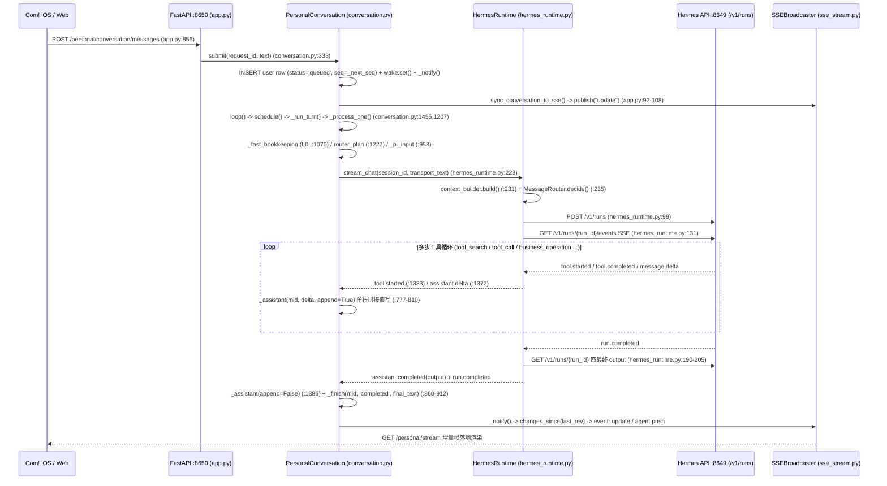
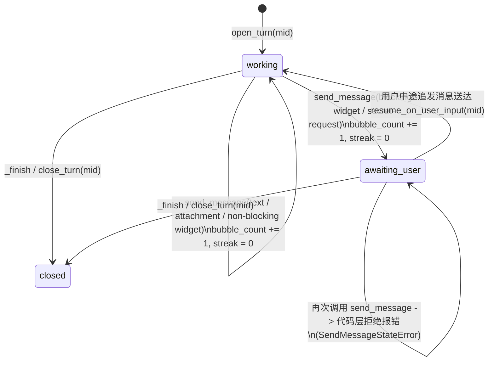

# Com! Personal Agent 发消息机制整合设计（第一阶段：仅后端）

- **日期**：2026-11-11
- **对应任务卡**：`_global/派活卡/2026-11/1111-0756-personal-agent-sendmessage/task.md`
- **范围边界**：第一阶段只改 `会话工作台/backend/`（含配套单测与本地全链路模拟验证），**不改 `ios/Com/` 任何文件、不做 iOS 编译、不重启线上 `127.0.0.1:8650` 与 `:8649` 服务、默认开关关闭（`send_message = "off"` 时行为与现网 100% 一致）**。
- **核心目标**：让 Com! 主对话同时满足两点——**收到消息第一时间先回一句确认气泡**，同时**在同一轮里直接调工具干活、进度气泡与工具调用自然交错（边干边报）**，且 Eddie 在处理中途追发的新消息能被后端事件队列稳稳接住，在下一 step 一并处理、压哨不丢。

---

## 一、现状全链路梳理与“为什么今天不跟手”

### 1.1 当前“用户发消息 → 模型跑 → 回复推到 Com!”全链路



关键代码坐标：

| 阶段 | 文件与函数 | 行号 | 当前行为 |
| --- | --- | --- | --- |
| 消息入队与序号分配 | `backend/conversation.py` `PersonalConversation.submit` | `333-384` | 校验 `request_id` 幂等，分配单调递增 `message_seq = _next_seq(db)`，写 `messages`（`role='user', status='queued'`），触发 `self.wake.set()` 与 `self._notify()` |
| SSE 增量广播 | `backend/app.py` `sync_conversation_to_sse` + `backend/sse_stream.py` `SSEBroadcaster` | `app.py:92-112, 783-812`；`sse_stream.py:162-252` | 监听 `_on_notify`，按 `revision` 差量查 `changes_since(last_rev)`，写入 `SSERingBuffer(capacity=1000)` 并向在线客户端推 `event: update` 与 `agent.push` |
| 主回合调度与分身 | `backend/conversation.py` `schedule` / `_is_supplement` / `_deliver_supplements` | `1012-1065, 1455-1476` | 仅当文本匹配刚性前缀（`补充：`、`改成`、`不要…`）或显式引用当前轮时才走 `steer_chat`；否则 `schedule()` 直接新开并行 `lane`（`-p1`） |
| 上下文组装与路由 | `backend/context_builder.py` `build` + `backend/hermes_runtime.py` `stream_chat` | `context_builder.py:17-44`；`hermes_runtime.py:223-259` | 组装 `SYSTEM_PROMPT`（受 `<2200` 字符预算约束）+ 滚动摘要 + 8 条只读历史，`MessageRouter` 判 L1/L2/L3 推理档后调 `POST /v1/runs` |
| 流式事件消费与落库 | `backend/conversation.py` `_process_one` / `_assistant` / `_finish` | `777-810, 860-919, 1304-1447` | 按 `parent_id = mid` 查找**唯一一条** `assistant` 行反复拼接/覆盖，直到 `run.completed` 才定稿 |

### 1.2 今天回复“不跟手”的四个根因卡点

1. **卡点一：单气泡覆写模型 + 终态 `output` 回写吞掉中途话术（结构性卡点）**
   - `PersonalConversation._assistant()`（`conversation.py:782-795`）查询条件是 `SELECT id,text FROM messages WHERE parent_id=? AND role='assistant'`，一轮用户消息在数据库里只允许存在**唯一一行** assistant 回复。所有流式 token 都往同一个气泡里硬拼，物理上无法形成“先发一条确认气泡 → 调工具 → 再发一条进度气泡 → 最后发结果气泡”的对话节奏。
   - 更致命的是：Hermes `/v1/runs/{run_id}` 的终态 `result["output"]` 只保留最后一轮 turn 的最终文本（不含中途 commentary，见 `api-server.md:499`）。当 `hermes_runtime.py:194-205` 在跑完工具后发出 `assistant.completed({'content': output})`，`conversation.py:1386` 调用 `_assistant(mid, content, append=False)` 并在 `conversation.py:888-891` 的 `_finish()` 里整行覆盖 `messages.text`——就算模型在调工具前先输出了一句“我先帮你查日历”，等工具跑完也会被最终答案直接抹掉或闪变。
2. **卡点二：工具调用期间模型默认“闭嘴干活”，等全部工具串行跑完才一次性吐长文**
   - 在工具调用回合中，大模型默认只返回 `tool_calls`（`content=""`），再加上 Hermes 的 MCP 工具默认走 `tool_search -> tool_describe -> tool_call` 延迟发现（2～3 步起跳），叠加业务读写回查动辄 4～7 步，用户在手机上只能盯着转圈或静态步骤条干等 8～25 秒，直到最后一步才突然弹出整段结果。
3. **卡点三：缺少运行时状态机与进度催报中间件，仅靠软性提示词约束不住节奏**
   - `hermes_prompt.py` 有严格的 `< 2200` 字符测试红线，既塞不下细致的节奏指导，放在 system prompt 顶部也会在多步工具调用后注意力衰减；
   - 同时缺少代码级状态机（发完交互卡片/待确认问题后无法在代码层禁止模型继续喋喋不休追加气泡）和连续工具调用计数器（模型闷头连调 5～6 次工具时没人催它向用户吱一声）。
4. **卡点四：中途追发消息被误拆到平行分身，或压哨竞态卡死在 `unknown`**
   - `_is_supplement()`（`conversation.py:1025`）只认 `补充：`、`更正：`、`改成`、`不要…` 等死板前缀。Eddie 在任务执行中自然追发一句“顺便把晚上七点健身也加上”，不命中正则，就会被 `schedule()`（`conversation.py:1471-1474`）丢进隔离的 `-p1` 分身会话，既看不到正在跑的上下文，也容易造成两边重复操作。
   - 即便命中了 `steer_chat`（`hermes_runtime.py:260-280`），若追发消息刚好卡在 Hermes 最后一批工具跑完、准备结束 run 的瞬间入队，Hermes 会把未消费的文本放在终态 `result["pending_steer"]` 返回，而 `hermes_runtime.py:190-205` 目前忽略了该字段，导致 `conversation.py:1443` 把这条追发消息标成 `status='unknown'`（提示“补充执行或送达结果待核实，未自动重试”），消息实质性丢失。

---

## 二、对标 Grok Bot 与 OpenHands：借用与本地化改造决策

| 机制维度 | 参考实现做法 | Com! 采纳策略 | 本地化改造原因与细节 |
| --- | --- | --- | --- |
| **发消息即工具（核心倒置）** | Grok Bot：普通文本视为内部思考丢弃；每次调用 `SendMessage` 产出一个独立用户可见气泡 | **直接借用** | 开启开关后，`PersonalConversation._process_one` 拦截 `assistant.delta` / `assistant.completed`，普通文本只写内部诊断表 `turn_thinking_logs`，绝不写 `messages`、不推 SSE；每次 `send_message` 工具调用独立插入一行 `role='assistant'` 气泡并即时广播 |
| **气泡 `type` 枚举** | Grok Bot：`text \| attachment \| widget \| cursor-agent \| secret-request` 五类 | **裁剪为四类** | 按任务卡定稿实现 `text \| attachment \| widget \| secret-request` 四种，`cursor-agent` 明确不做并在校验层拒绝返回可读纠错提示 |
| **工具边界 Schema 跨字段校验** | Grok Bot：Zod + `superRefine` 拦截缺字段、跨字段混填、非法 URI scheme，报错回填给模型自修 | **直接借用（Python 实现）** | `SendMessageValidator` 做枚举 + 跨字段强校验；失败抛 `SendMessageValidationError(ValueError)`，经 FastAPI 409 / FastMCP `isError=True` 原路回给模型下一步重试，脏数据零落库 |
| **节奏 Guidance 注入位置** | Grok Bot：不进 System Prompt，包在 `<system_reminder>` 追加到每次 user turn 末尾 | **借用并适配路由顺序** | `hermes_prompt.py` 保持 0 改动（守住 `<2200` 字预算与 KV Cache 前缀）；在 `HermesRuntime.stream_chat` 完成 `MessageRouter.decide()` 判分**之后**再把 `<system_reminder>` 拼到送往 `/v1/runs` 的 `input` 末尾，既不污染用户落库原文，也不干扰快慢模型路由；并在提醒内附带 `mcp__com_workbench__send_message` 简明参数说明，支持 Hermes `tool_call` 一步直调免去 `tool_search` 往返 |
| **零气泡收尾防护** | Grok Bot：靠 `<system_reminder>` 约束 | **增强：1-shot 自愈重试** | 若模型偶发整轮只输出思考文本、`bubble_count == 0` 就结束，后端触发最多 1 次同会话短续跑提醒模型调 `send_message` 发出答复；仍为 0 则标 `unknown` 留痕，绝不把未校验思考裸露给 UI |
| **会话状态机（等用户禁发）** | Grok Bot：发出阻塞型 `widget` / `secret-request` 后进入等待用户态，同轮再调 `SendMessage` 报错拦回 | **直接借用** | SQLite `send_message_turns` 维护 `working -> awaiting_user -> closed`；处于 `awaiting_user` 时任何后续 `send_message` 直接拒绝并提示模型停手等待下一轮；若用户中途发来回复则自动切回 `working` |
| **进度提醒中间件** | Grok Bot：连续 6 次非 `SendMessage` 工具调用后注入提醒催报进度 | **借用，阈值调优为 `N=4`** | Com! 手机对话硬规则是“一般问题 ≤ 8 次工具调用”（`hermes_prompt.py:7`），设 6 几乎快跑完才触发；默认设 `send_message_remind_after = 4`（支持 `2..12` 配置），经 `/v1/runs/{run_id}/steer` 注入 `<system_reminder>` |
| **文件走文件系统 + SHA-256 内容寻址** | Grok Bot：正文只传 `file://` / `https://`，字节走 SHA-256 内容寻址存储，不进上下文 | **借用并打通 `ArtifactAccess`** | `type="attachment"` 接收 `file://` 时先过 `ArtifactAccess._safe` 安全边界（禁软链、禁隐藏目录、禁越界），流式算 SHA-256 存入 `~/.session-workbench/cas-blobs/`，同时注册 `ArtifactAccess` 生成鉴权下载路径 `/personal/artifacts/art_...`，模型上下文零文件字节 |
| **处理中追发新消息（Event Queue）** | OpenHands `18_send_message_while_processing.py`：`send_message()` 随时追加事件，后台 `run()` 在下一个 `Agent.step()` 一并消费 | **借用并补齐压哨重排** | 开关开启时，正在处理的主轮次期间到达的普通新消息（除显式 `new_item` 外）一律进入本轮事件队列，毫秒级唤醒并 `steer_chat` 注入下一 step；若恰逢 run 收尾未消费（`not_sent` 或出现在 `pending_steer`），自动原子重排回 `queued` 紧接着开下一轮跑完，彻底杜绝丢消息 |

---

## 三、后端核心机制详细设计

### 3.1 `send_message` 工具定义与跨字段校验（`backend/send_message.py`）

工具名在 MCP 层注册为 `send_message`（Hermes 内完整名为 `mcp__com_workbench__send_message`），`AgentTools.call` 同时兼容 `"send_message"` 与 `"SendMessage"` 别名，并加入 `hermes_metrics/source_binding.py::SOURCE_TOOLS` 与 `hermes_mcp.py::compact_tool_schemas()`，由宿主钩子或当前唯一活跃轮次自动绑定真实用户来源（模型无需手抄 `origin_*` 三元组）。

#### 参数与四类 `type` 跨字段规则

```python
send_message(
    type: Literal["text", "attachment", "widget", "secret-request"],
    content: str = "",                       # text 必填；widget 可选引导语；attachment / secret-request 禁填正文大段内容
    url: str = "",                           # attachment 必填（仅限 file:// 或 https://）
    caption: str = "",                       # attachment 可选简短说明（≤ 240 字）
    images: list[str] | None = None,         # text 可选附图引用（每项必须为 file:// 或 https://，最多 9 张）
    suggestions: list[str] | None = None,    # text 可选快捷追问词（最多 4 项，每项 ≤ 24 字）
    widget: dict[str, Any] | None = None,    # widget 必填结构化描述
    secret_name: str = "",                   # secret-request 必填（^[A-Za-z_][A-Za-z0-9_.-]{1,63}$）
    reason: str = "",                        # secret-request 必填（向用户解释用途，≤ 300 字）
    target_env: str = "",                    # secret-request 可选目标配置项说明
    placeholder: str = "",                   # secret-request 可选输入占位提示
)
```

跨字段校验矩阵（`SendMessageValidator.validate`）：

1. **`type` 枚举强约束**：仅允许 `{"text", "attachment", "widget", "secret-request"}`。传入 `"cursor-agent"` 或其它值直接报错：`SendMessage 校验失败：不支持的 type='...'，仅允许 text | attachment | widget | secret-request（cursor-agent 当前阶段不启用）。`
2. **`type == "text"`**：
   - `content.strip()` 必须非空且长度 `<= 12000`；
   - 严禁混传 `url`、`widget`、`secret_name`（防止模型把附件或组件塞进文本气泡）；
   - `images` 若提供，必须为 `1..9` 项列表，每项必须以 `file://` 或 `https://` 开头；本地 `file://` 图片同样经过安全路径检查与 SHA-256 寻址登记。
3. **`type == "attachment"`**：
   - `url.strip()` 必须非空，且 URI scheme 仅允许 `file://`（指向被允许的工作区 / `Documents` / `Downloads` 内真实非隐藏文件，禁止符号链接与敏感目录）或 `https://`；裸路径或 `http://` 外链直接拒绝并给出改成 `file:///...` 或 `https://...` 的具体提示；
   - 严禁传 `content`、`widget`、`secret_name`（说明文字只能放 `caption`，`<= 240` 字），从结构上杜绝“把文件内容贴进正文气泡”；
   - 本地 `file://` 经流式读取（64 KB 分块）计算 SHA-256，硬链接/落盘至 `~/.session-workbench/cas-blobs/<sha256[:2]>/<sha256><ext>`（权限 `0600`），并调用 `ArtifactAccess.register(bubble_id, path)` 生成受鉴权的 `/personal/artifacts/art_...` 引用。
4. **`type == "widget"`**：
   - `widget` 必须为 `dict`，`kind` 归一为 `confirm | picker | checklist | form` 四类之一，`title` 必填非空：
     - `confirm`：可选 `message`、`confirm_label`（默认 `"确认"`）、`cancel_label`（默认 `"取消"`）、`confirm_reply`、`cancel_reply`；
     - `picker`：`options` 必须为非空列表（`1..12` 项，支持字符串或 `{"label", "value"}`）；
     - `checklist`：`items` 必须为非空列表（`1..20` 项）；
     - `form`：`fields` 必须为非空列表（`1..10` 项，每项含 `name` 与 `label`）；
   - 默认 `blocking = bool(widget.get("blocking", True))`，发出阻塞型 widget 后会话状态立即切为 `awaiting_user`。
5. **`type == "secret-request"`**：
   - `secret_name` 必须匹配 `^[A-Za-z_][A-Za-z0-9_.-]{1,63}$`，`reason.strip()` 必须非空（`<= 300` 字）；
   - 严禁在任何字段中携带真实密钥值；发出后会话状态立即切为 `awaiting_user`。

### 3.2 普通文本视为内部思考与 1-Shot 自愈守卫

当 `superagent_flags.send_message_on()` 为 `True` 时：

1. **普通文本静默归档**：
   - `PersonalConversation._process_one()` 中收到 `assistant.delta` 与 `assistant.completed` 时，**不再调用 `self._assistant()`**，也不向 `messages` 表写入任何记录；
   - 拼合后的普通文本写入 SQLite 诊断表 `turn_thinking_logs(id, message_id, request_id, run_id, step_index, content, created_at)`，仅供排障核查，永远不下发给客户端。
2. **节奏 Guidance（`<system_reminder>` 追加在每次 User Turn 末尾）**：
   - 不改动 `backend/hermes_prompt.py` 一字；
   - 在 `HermesRuntime.stream_chat()` 完成 `MessageRouter.decide()` 之后（以及非 Hermes 测试客户端进入 `stream_chat` 前），向发给模型的 user 输入末尾追加 `<system_reminder>...</system_reminder>`，明确三拍节奏：
     - **需要调工具时**：第一步必须在同一轮响应里**同时发出简短确认气泡 `send_message(type="text", content="...")` + 第一个工具调用**；
     - **多步执行中途**：有阶段性结论或切换动作时补发简短进度气泡；纯闲聊/一步直答只调一次 `send_message` 直接给答案，不拆废话双气泡；
     - **最终结果发完即停**：不要再输出重复总结，发出 `widget` / `secret-request` 后立刻停手等用户。
3. **零气泡收尾单次自愈（1-Shot Self-Repair）**：
   - 若某轮 `run.completed` 时 `store.bubble_count(mid) == 0`（模型忘了调 `send_message` 只写了内部思考），且 `client` 支持同会话续跑（`HermesRuntime` 或支持多轮 `stream_chat` 的客户端），`_process_one()` 自动发起**最多 1 次**内部修复续跑（输入 `<system_reminder>你刚才只输出了内部思考文本，Eddie 手机上什么都没看到。请立即调用一次 send_message 把答复发给 Eddie，然后结束本轮。</system_reminder>`）；
   - 修复成功（`bubble_count >= 1`）则正常以 `completed` 收尾；若仍未发出任何气泡，则将用户消息标为 `unknown`（报错说明未产生可见回复），绝不把未校验的内部思考文本裸塞进聊天气泡。

### 3.3 会话状态机（`SendMessageStore`）

在 `personal-conversation.sqlite` 中新增表 `send_message_turns`：



- 当 `state == "awaiting_user"` 时，模型在同一轮若继续调用 `send_message`（例如发完确认选择器后又自己往下猜着发结论），`SendMessageStore.authorize_and_record()` 直接抛出 `SendMessageStateError`：
  > `SendMessage 被拒绝：本轮已发出 widget/secret-request 并在等待 Eddie 响应（state=awaiting_user）。请立即停止本轮工具调用与输出，等待用户下一条消息。`
- 该错误作为 `isError=True` 工具结果返回给模型，不会写入 `messages`，也不会触发 SSE 推送。

### 3.4 进度提醒中间件（`ProgressReminderMiddleware`）

- **阈值建议与依据**：默认 `remind_after = 4`（可通过 `superagent-flags.json` 的 `send_message_remind_after` 在 `2..12` 间调整）。相比 Grok Bot 的 `6`，Com! 主对话服务手机端轻量交互（目标 `<= 8` 次工具调用），连续 4 次非 `send_message` 工具完成仍未向用户发声时（约耗时 5～8 秒），正好处于需要一句进度交代的黄金节点。
- **精确识别机制（兼容直调与 Hermes `tool_call` 包装）**：
  - 在 `_process_one()` 的 `tool.started` 记录 `bubbles_before = send_store.bubble_count(mid)`；
  - 在 `tool.completed` / `tool.failed` 对比 `bubbles_after = send_store.bubble_count(mid)`：
    - 若 `bubbles_after > bubbles_before`（说明本次工具调用期间成功发出了至少一条 `send_message` 气泡，无论外层事件名是 `send_message` 还是 Hermes 的 `tool_call` 批量调用），连续静默计数已在 `emit_bubble` 时归零；
    - 否则调用 `send_store.note_silent_tool(mid, threshold=remind_after)` 将 `non_send_tool_streak += 1`。
  - 当 `state == "working"` 且 `non_send_tool_streak >= remind_after` 时：
    - 计数归零、`reminder_count += 1`；
    - 调用 `await client.inject_reminder(session_id, reminder_text)`，向 `POST /v1/runs/{run_id}/steer` 注入系统提醒（独立方法，**不写**用户补充表 `steering`，不污染 `user_events` 投递状态）：
      ```xml
      <system_reminder>
      你已连续执行 4 次工具调用但还没向 Eddie 同步进展。下一步请真正发起一次 send_message(type="text", content="...") 用一句话交代当前查到了什么/正在做什么，同时继续后续工具调用（不要在普通文本里假装已回复）。
      </system_reminder>
      ```

---

## 四、SSE 流式传输与未来 iOS 按 `type` 渲染接口约定

### 4.1 传输层结论：直接复用现有 `SSEBroadcaster`，零协议破坏

现有 SSE 链路（`GET /personal/stream` 与 `GET /personal/conversation/stream`，`app.py:92-112, 783-812` + `sse_stream.py:162-252`）基于 `PersonalConversation.revision` 差量快照工作：

1. 模型在工具链任意时刻调用 `send_message` → `AgentTools.call("send_message")` → `PersonalConversation.emit_bubble()`；
2. `emit_bubble()` 在单次 SQLite 事务内插入一条独立 `role='assistant', status='completed', phase='completed'` 的气泡行，分配全新 `id`、`message_seq = _next_seq(db)` 与 `revision = _bump(db)`，同时更新父用户消息的 `received_at`（首泡即刻打上接收回执时间戳），随即调用 `self._notify()`；
3. `_on_notify` 同步触发 `sync_conversation_to_sse()`，将 `changes_since(last_rev)`（仅含这条新气泡和父消息状态更新）写入 `SSERingBuffer` 并实时推给所有在线客户端（本地进程内实测端到端广播延迟 `< 5 ms`）；
4. 断线重连场景自动命中 `SSERingBuffer.get_since(cursor)` 按 `event_seq` 补帧，无需新增私有 SSE 事件帧格式即可让线上 iOS / Web 客户端实时浮现每一条进度气泡。

### 4.2 消息结构与 App 侧未来按 `type` 渲染契约（Phase 2 接口约定，本阶段不改 iOS）

`messages` 表新增两个向后兼容字段：
- `bubble_type TEXT NOT NULL DEFAULT 'text'`
- `bubble_payload TEXT`（JSON 字符串，仅由经校验的 `send_message` 写入）

`_project_message()` 下发的单条 assistant 消息 JSON 同时包含**新类型契约字段**（供下一阶段 iOS 原生按 `bubble_type` 分支渲染）与**第一阶段兼容投影字段**（让当前未改代码的线上 iOS App 也能正常显示文字、文件架卡片与交互组件）：

```json
{
  "id": "9f8c2a...",
  "parent_id": "3a1b4c...",
  "role": "assistant",
  "status": "completed",
  "phase": "completed",
  "message_seq": 1042,
  "created_at": 1794356401.125,
  "updated_at": 1794356401.125,
  "bubble_type": "attachment",
  "bubble": {
    "type": "attachment",
    "url": "file:///Users/eddiegao/AI_Work_System/work/航程产出/weekly-summary.pdf",
    "scheme": "file",
    "caption": "本周复盘 PDF 已生成",
    "name": "weekly-summary.pdf",
    "mime": "application/pdf",
    "size": 84210,
    "sha256": "e3b0c44298fc1c149afbf4c8996fb92427ae41e4649b934ca495991b7852b855",
    "cas_relpath": "cas-blobs/e3/e3b0c442...pdf",
    "artifact_id": "art_7d91...",
    "download_path": "/personal/artifacts/art_7d91..."
  },
  "text": "本周复盘 PDF 已生成",
  "artifacts": [
    {
      "id": "art_7d91...",
      "name": "weekly-summary.pdf",
      "mime": "application/pdf",
      "size": 84210,
      "availability": "available",
      "download_path": "/personal/artifacts/art_7d91..."
    }
  ],
  "widgets": [],
  "suggestions": []
}
```

#### 下一阶段 iOS 客户端按 `bubble_type` 分支渲染约定（Swift 侧只读规范）

| `bubble_type` | `bubble` 核心结构 | iOS 第二阶段目标渲染组件 | 第一阶段（不改 iOS）兼容表现 |
| --- | --- | --- | --- |
| `"text"` | `{type:"text", content:String, images:[ImageRef], suggestions:[String]}` | `TextBubbleView` + 内联图片九宫格缩略图 + 底部 `suggestions` 胶囊 | `text` 显示正文，本地图片自动挂入 `artifacts` 架，`suggestions` 原生生效 |
| `"attachment"` | `{type:"attachment", url, scheme, caption, name, mime, size, sha256, artifact_id, download_path}` | 独立 `AttachmentCardBubble`（文件图标 + 文件名 + 体积 + QuickLook 预览 / 外链打开，不渲染空文本泡） | `text` 显示 `caption`（空则为 `已附上文件：<name>`），`artifacts` 数组直接驱动现有成果卡片点击预览下载 |
| `"widget"` | `{type:"widget", content, blocking:Bool, widget:{kind:"confirm\|picker\|checklist\|form", title, ...}}` | 独立交互组件气泡 `WidgetBubbleView`；用户点选后回发结构化确认消息并解除等待态 | `text` 显示引导语，`widgets` 数组直接填充结构化 widget 对象供现有 `reply_widgets` 视图消费 |
| `"secret-request"` | `{type:"secret-request", secret_name, reason, target_env, placeholder, masked:true}` | `SecretEntryBubbleView`（SecureField 掩码输入 → 直投安全凭据接口，绝不进聊天历史） | `text` 显示明确脱敏提示（提醒勿在普通输入框粘贴明文密钥） |

---

## 五、中途追发消息事件队列（对标 OpenHands `18_send_message_while_processing.py`）

### 5.1 入队规则与 Step 级注入

当 `superagent_flags.send_message_on()` 为 `True` 时：

1. **放宽入队判定 `_should_enqueue_mid_turn(row, active_mid)`**：
   - 只要当前存在正在运行的主对话轮次 `active_mid`，且新到达的 `queued` 用户消息**没有**显式标记 `new_item`（“改为新事项”），也**没有**显式引用另一条无关历史消息，则一律归入当前活跃轮次的事件队列（若有多条并行轮次，归入最新启动的主轮次），不再因为没写“补充：”前缀就被 `schedule()` 拆去孤立的 `-p1` 分身。
2. **毫秒级事件唤醒（替代 50ms 轮询等待）**：
   - `PersonalConversation` 新增 `self.mid_turn_event = asyncio.Event()`，`submit()` 落库后立即 `self.mid_turn_event.set()`；
   - `_deliver_supplements()` 通过 `asyncio.wait_for(self.mid_turn_event.wait(), timeout=0.05)` 即刻醒来取走新消息：
     1. 调用 `self.send_store.resume_on_user_input(active_mid)`，若当前轮处于 `awaiting_user` 则立即解锁回 `working`；
     2. 构造带 `<system_reminder>` 的补充上下文（提示模型“Eddie 在你处理中途刚追发了这条新消息，请在下个 step 一并纳入处理并通过 `send_message` 回应”）；
     3. 调用 `await client.steer_chat(session_id, text, row['request_id'], context)` 推入 Hermes 当前 run 的 `steer_queue`，Hermes 在当前工具 step 结束进入下一 `Agent.step()` 前自动将其作为真实 user 消息注入对话。

### 5.2 压哨竞态零丢消息闭环（Pending-Steer Requeue）

针对“追发消息刚发进 `/steer`，Hermes 最后一步恰好跑完退出循环”的边界竞态：

1. `HermesRuntime.stream()` 在轮询终态 `GET /v1/runs/{run_id}`（`hermes_runtime.py:190`）时读取 `pending_steer = result.get("pending_steer") or []`，识别出所有带 `[Com supplement <request_id>]` 标记但**未被模型实际消费**的请求 ID 集合 `unconsumed_request_ids`（同时把 `steering` 表里对应行的 `state` 更新为 `'unconsumed'`，随 `run.completed` 事件一并传回 `PersonalConversation`）。
2. `PersonalConversation._process_one()` 的 `finally:` 块在结算本轮追发消息时先将 `mid` 放入 `self.closing_turns`（防止 `schedule()` 把刚回退的追发消息又误判进正在销毁的旧轮次，或抢走 `lane 0` 拆去孤立 `-p1` 分身），同时 `loop()` 将 `self.wake.clear()` 前置到 `schedule()` / `process_one()` 之前消除唤醒丢失窗口，并分三路处理：
   - **已被本轮消费且本轮完成**（`delivered` 且不在 `unconsumed_request_ids`）：将该追发消息标为 `'completed'`；
   - **压哨未消费，且原运行已干净结束**（`request_id in unconsumed_request_ids` 或 `steer_chat` 返回 `not_sent`）：**不再错误打成 `'unknown'`**，而是调用 `_requeue_supplement(supplementary_mid, request_id, client)` 原子将其重置为 `status='queued', phase='queued', supplement_to_message_id=None`、`user_events.state='queued'`，清理未消费的 `steering` 占位，在 `_run_turn` 释放 `lane 0` 后（`<1ms`）由主循环紧接着在 `lane 0` 原位作为下一轮回合立即执行！
   - **异常中断无法确认是否已产生副作用**：仍严格保持 `'unknown'` fail-closed 语义，绝不盲目重放不确定副作用。

---

## 六、专项风险评估：`message_seq` 回填与 iOS 排序比较器兼容性

针对 2026-11-08 修复过的 `message_seq` 回填与 `ios/Com/Core/ChatTimeline.swift` 排序逻辑，逐项核查如下：

1. **`message_seq` 严格单调递增，零 `<= 0` 空洞风险**
   - `PersonalConversation.__init__`（`conversation.py:206-209`）只在存在 `message_seq <= 0` 的历史脏行时才会执行 `UPDATE messages SET message_seq = rowid`。
   - 新增的 `emit_bubble()` 与既有的 `submit()`、`task_receipt()` 一样，全部在同一个 SQLite 写事务内调用 `self._next_seq(db)`（`conversation.py:232-235`），保证每条确认气泡、进度气泡、中途追发用户消息、最终结果气泡都拿到严格大于 `0` 且严格递增的整数 `message_seq`。因此永远不会触发全表 `rowid` 重算，也绝不会打乱历史序号。
2. **`ChatTimeline.rows` 比较器（`ios/Com/Core/ChatTimeline.swift:25-39`）完全兼容且时序自然**
   - iOS 端对非 pending 行优先比较 `if seqA > 0 && seqB > 0 && seqA != seqB { return seqA < seqB }`。
   - 多气泡 + 中途追发下的序号序列为：`用户消息1(seq=101) -> 确认气泡(seq=102) -> 进度气泡(seq=103) -> 用户追发消息2(seq=104) -> 最终结果气泡(seq=105)`。iOS 比较器直接排出的时间线与微信真人边做边聊的视觉顺序 100% 一致，不会发生气泡倒置或闪退。
   - 同时，`ChatDisplay.rows`（`ChatTimeline.swift:203-205`）原生已有 `consecutiveAgent: isAgent && previousIsAgent` 逻辑，连续多条 assistant 气泡会自动紧凑分组展示；且 `request_id` 不以 `task-result:` 开头，不会被 `isFoldable`（`ChatTimeline.swift:115-122`）误折进后台主动消息堆。
3. **已知小视觉点与第二阶段跟进建议：`ChatTimeline.answering` 连续气泡提示条**
   - 只读审计发现 `ChatTimeline.swift:48` 当前判断条件为 `rows[index - 1].message.id != parent`。当同一轮连续发出第 2、第 3 条气泡时，第 2 条气泡的前一行是第 1 条 assistant 气泡而非 user 行，当前 iOS 会在第 2、3 条气泡上方显示一个轻量的 `MessageAnsweringChip`（“回复：…”）。它**不影响排序、不闪退、不丢内容**（Siri 兜底 `ComSiriIntents.swift:67` 依赖 `parent_id == messageID` 取最后一条气泡，因此数据库和 JSON 必须保留真实 `parent_id`）。下一阶段改 iOS 时只需在 `ChatTimeline.swift:48` 补半句 `&& rows[index - 1].message["parent_id"].string != parent` 即可消掉连续同源气泡上的重复小标签。
4. **多气泡下 `_with_receipts`、`receipt()` 与 `unified_voice.py` 兼容修复**
   - `_with_receipts()`（`conversation.py:317-328`）：原先遍历所有 `parent_id in receipts` 的 assistant 消息挂操作回执，多气泡下会导致同一笔操作回执在每条进度气泡下重复出现。改为**只挂在该 `parent_id` 对应的最后一条 assistant 气泡上**（单气泡时行为完全不变）。
   - `receipt()`（`conversation.py:390`）、`turn_record()`（`conversation.py:737`）与 `UnifiedVoice.receipt()`（`unified_voice.py:39`）：统一改为 `ORDER BY message_seq DESC, created_at DESC LIMIT 1`，确保 Siri / 语音回执与航程回看取到的是本轮最终结果气泡，而不是第一句“收到，正在查”。

---

## 七、开关设计、改动文件行号清单与 P0 / P1 分级

### 7.1 Feature Flag 开关（默认关闭）

在 `~/.session-workbench/superagent-flags.json`（由 `backend/superagent_flags.py` 读取，文件不存在或未配置时默认全关）：

```json
{
  "router": "off",
  "mandate": "off",
  "herdr_write": "off",
  "send_message": "off",
  "send_message_remind_after": 4
}
```

- `SuperagentFlags.send_message_on() -> bool`：默认返回 `False`；同时支持进程环境变量 `COM_SENDMESSAGE_MODE=on|off` 覆盖（便于本地脚本和单测在不碰 `~/.session-workbench/superagent-flags.json` 的前提下独立验证）。
- 当 `send_message == "off"` 时：不注入 `<system_reminder>`，普通文本照常走 `_assistant()` / `_finish()` 流式单气泡，`_is_supplement()` 维持原正则，线上行为零变化。

### 7.2 落到文件与函数行号的改动清单及 P0 / P1 分级

| 优先级 | 文件路径 | 函数 / 位置（基于改前行号） | 改动内容 |
| --- | --- | --- | --- |
| **P0** | `backend/superagent_flags.py` | `DEFAULTS`, `VALID`, `SuperagentFlags` (`L12-47`) | 新增 `send_message: "off" \| "on"` 与 `send_message_remind_after`（默认 `4`，范围 `2..12`），提供 `send_message_on()` 与 `send_message_remind_after()` |
| **P0** | `backend/send_message.py`（新建） | 全新模块 | 实现 `SendMessageValidator`（四类 `type` 枚举与跨字段强校验）、`ContentAddressedStore`（本地 `file://` 流式 SHA-256 落库与安全边界复核）、`SendMessageStore`（会话状态机 `working`/`awaiting_user`/`closed` + 工具静默计数 + `turn_thinking_logs` 思考归档）、`build_turn_reminder()` 与 `build_progress_reminder()` |
| **P0** | `backend/conversation.py` | `__init__` (`L185-214`), `_with_receipts` (`L317-328`), `submit` (`L333-384`), `receipt` (`L386-391`), `_message_query` / `_project_message` (`L408-439`), `turn_record` (`L731-742`), `_finish` (`L860-919`), `_is_supplement` / `_deliver_supplements` (`L1012-1065`), `_process_one` (`L1207-1447`) | 1) `messages` 迁移 `bubble_type` / `bubble_payload` 列并投影 `bubble_type` + `bubble`；<br>2) 新增 `emit_bubble()` 独立落库 + `_next_seq` + `_notify()` 即时推 SSE；<br>3) Flag 开启时拦截普通文本入 `turn_thinking_logs`、接入进度提醒中间件与 1-shot 零气泡自愈；<br>4) 中途追发消息事件队列（`mid_turn_event` 即时唤醒 + 压哨未消费自动回退 `queued` 重排）；<br>5) `_with_receipts` 仅挂末条气泡，`receipt`/`turn_record` 按 `message_seq DESC` 取末条 |
| **P0** | `backend/hermes_runtime.py` | `stream` (`L188-206`), `stream_chat` (`L223-259`), `reconcile_steering` (`L281-294`), 新增 `inject_reminder` | 1) `stream_chat` 在 `MessageRouter.decide` 之后按开关向 `input` 末尾追加 `<system_reminder>`，并记录首条气泡/文本耗时；<br>2) 新增 `inject_reminder()` 向 `/v1/runs/{run_id}/steer` 注入进度催报而不污染用户 `steering` 表；<br>3) 终态读取 `result["pending_steer"]` 识别未消费补充消息并回传 `unconsumed_supplements` |
| **P0** | `backend/agent_tools.py` | `AgentTools.call` (`L88-226`) | 接入 `send_message` / `SendMessage` 工具分发：解析并核验当前真实回合来源，走 `SendMessageValidator` + `ContentAddressedStore` + `ArtifactAccess` + `SendMessageStore` + `conversation.emit_bubble()` |
| **P0** | `backend/hermes_mcp.py` + `backend/hermes_metrics/source_binding.py` | `_shared` (`L308-317`), 新增 `@mcp.tool() def send_message`, `compact_tool_schemas` (`L498-528`)；`SOURCE_TOOLS` (`source_binding.py:7-12`) | 注册 MCP `send_message` 工具、加入 `SOURCE_TOOLS` 自动注入来源且支持 `_active_source()` 兜底、精简模型可见 Schema |
| **P1** | `backend/unified_voice.py` + `backend/context_working_set.py` + `backend/app.py` | `UnifiedVoice.receipt` (`unified_voice.py:39`)；`history` (`context_working_set.py:70`)；`health` (`app.py:582-610`) & `agent_tools` 装配 | 1) 语音回执按 `message_seq DESC` 取末条气泡；<br>2) 工作集历史按 `message_seq DESC` 稳定保序；<br>3) `/health` 的 `features` 暴露 `personal_send_message_v1` 当前开关状态，装配 `agent_tools.artifact_access` |
| **P2（下一阶段，本次不动）** | `ios/Com/Core/ChatTimeline.swift` + `ios/Com/Views/ChatView.swift` | `ChatTimeline.answering` (`L48`) + 气泡视图层 | iOS 原生按 `bubble_type` 渲染四类独立组件（`AttachmentCardBubble` / `WidgetBubbleView` / `SecretEntryBubbleView`），并优化连续同源气泡的 `answering` 判断 |
