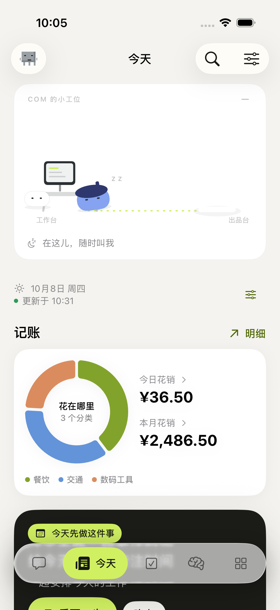

# report.md 补齐记录 · iOS 2026100802

801 的状态条不能算完成报告的工作舞台。本次沿当前 Com / Hermes 服务补齐，而不是迁移到报告里不存在的另一套后端。用户确认：舞台和图标都采用白蓝脸，动作采用报告方案。

## 工作舞台

「今天」和聊天页均有约 240 pt、可收起的完整白色舞台：电脑与转椅、青柠虚线路径、发光出品台。白脸留在工作台，戴蓝色贝雷帽的蓝脸负责工作和递送；图标保持原有白蓝双脸。

| 报告明确列出的动作 | 实现 |
|---|---|
| 思考 | 坐在椅边晃头，思想气泡的三个点轮流点亮 |
| 查资料 | 拿放大镜探头，镜片扫描线移动 |
| 打字/写代码 | 敲键盘，屏幕文字行移动 |
| 待确认 | 转身举「等你拍板」牌后停住，按钮打开任务页 |
| 交付 | 抱纸沿路径加减速跑动，放到出品台，真实回复摘要弹起，然后回到休息状态；可点「查看回复」定位消息 |
| 失败 | 短暂红屏、受惊和挠头后停住；只显示服务端实际提供的重试次数，不假装自动重试 |
| 空闲 | 白蓝脸趴下，短暂安顿动作后静止，保留 Z z 与待命文案 |

另外有查记忆、查日程、分派工作的道具状态。用户提供的主报告仅明确列出上述七项；其中链接的 `sandbox://` 子报告未随文件提供，不能声称验证了未提供的“完整 12 步”细则。

动画由隔离的 Canvas 绘制，30 Hz 上限；聊天/今天滚动时暂停，低电量、减少动态效果、后台及非当前页静止。聊天列表不随动画帧更新。此处的 30 Hz 是小舞台的节能刷新上限，不是聊天滚动的帧率限制。

## 事件与收尾

- 保留原有带 revision 的 `snapshot/update`，额外发送 `task.progress / task.review / agent.push / heartbeat`。新增事件不抢占历史恢复游标；这是一套兼容扩展，不宣称完整 AG-UI 标准实现。
- 后端从真实会话、活跃工具和持久任务派生状态。重连先建立历史基线；同一消息完成只交付一次，不按文字相似度判断。
- Swift 纯状态机统一动画和文案。交付状态在 2.8 秒后结束；待确认优先；30 秒没有工作进展则停止忙碌，35 秒连心跳都没有则提示恢复连接。心跳只证明链路，没有伪造进度。
- 工具结束即随下一帧切换状态，不增加人为等待；手机网络下 800 ms 的端到端上限未作保证。
- 新回复/待确认可发本地通知；通知去重，点待确认进入任务页，点回复定位原消息。前台聊天时不重复横幅。前台 SSE 不等于 App 被杀后仍在线。

## 同时补齐

- **Com launchd 每日日志轮转**：在写日志的服务进程里 rename + dup2 切换文件描述符，不 copy/truncate；保留最近 7 个本轮创建的归档。由 `COM_SERVICE_LOGS=1` 启用，安装脚本及 mini plist 已设置。此项针对 Com stdout/stderr，未接管其他软件日志。
- **锁屏/桌面数量组件**：显示最后一次同步的简报/待确认数量与更新时间，超过一小时显示需要更新，不把旧数当实时状态。点击打开今天或任务页。小组件使用独立 Keychain 共享组，仅存数量与时间；API 凭据仍在 App 自己的组。签名构建通过，真机锁屏添加及显示尚未验收。
- **旧 iOS 分支**：`review/ios-ui-rewrite-20261007` 已完全包含于当前 main（比较时 main 领先 5、分支独有 0）。保留作为既有工作树引用，不合并重复提交或删除工作树。

## 验证及真实边界

- 后端 534 项回归、Swift Core 8 项通过；新增用例覆盖交付去重、历史基线、工具收尾、异常、等待确认优先级、心跳看门狗、写入期间日志轮转。
- 模拟器验证舞台展开/收起、今天页展示；滚动与新消息不拉动阅读位置、平滑回到最新、语音自动发送和取消后不发送迟到转写。截图使用隔离 fixture，视频过程已逐帧检查；不作为线上真实任务成果。
- iOS Release **2026100802** 已安装到连接的 iPhone，并读回构建号。随后远程启动被锁屏拦截，未宣称真机持续 120 FPS 或锁屏组件验收完成。
- Mini 源码经 Syncthing 同步核对 118 个后端文件，无主聊天、worker 和原生 lease 执行时重启 Com，Hermes 模型及插件不变。

## 报告仍未完成或不适用的项目

这不是一份“全报告已完成”声明：

- Bark 未接入，现场未发现已配置的设备端点；现有 APNs/系统后台刷新不等于已验证的 Bark 杀后台推送。
- 每周自动记忆 garden、便宜模型历史摘要、连续一周的主动性品质以及“两周前偏好召回”长期验收，未在本次完成。现有 Markdown 权威写入、版本记录、建议队列、节律任务和按需 recall 保留。
- 当前真实 HTTPS、launchd、运行时适配、MCP、任务收据和审批已存在；报告提到的 `/usr/bin/true` 空壳、`~/workspace/personal-agent` 未在现场发现，不另建空壳或降级 HTTP。
- 不按长期路线图强行迁移 PostgreSQL；报告 P1 也明确允许 SQLite WAL。现有幂等及不确定结果不自动重放的边界继续有效。

Keychain 共享依据：[Apple 官方说明](https://developer.apple.com/documentation/security/sharing-access-to-keychain-items-among-a-collection-of-apps)。独立组使小组件只能读取计数，不扩大到 App 默认凭据组。
